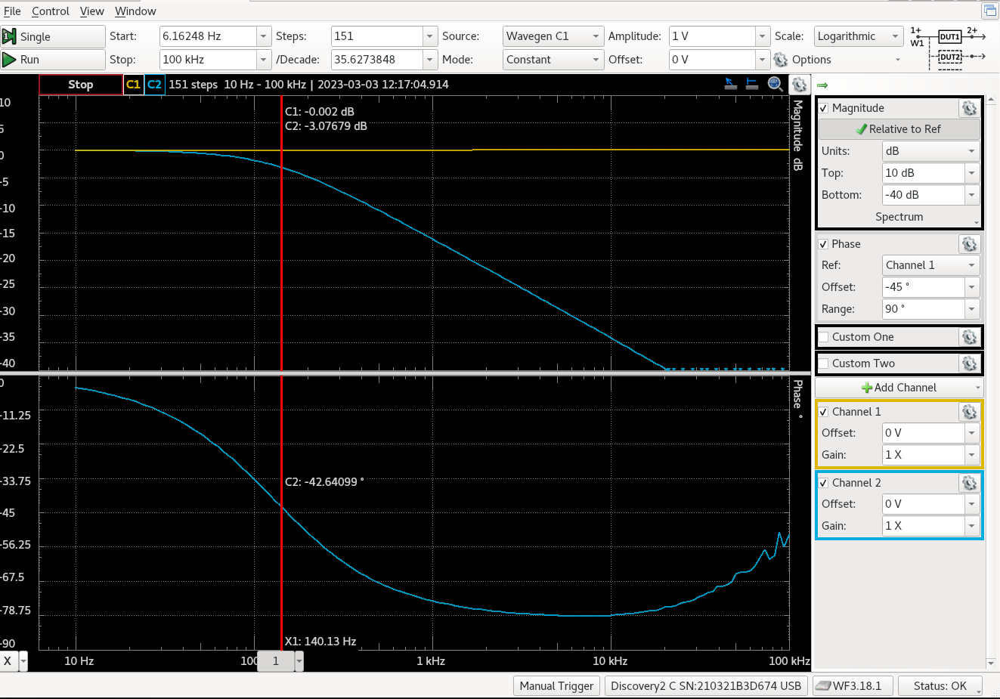

# Media — Assignment 3

Supporting visual material for **IN1080: Mechatronics**, Assignment 3.

## RC Low-Pass Filter Result

The screenshot below shows the measured magnitude and phase response of an RC low-pass filter built using a **1 kΩ resistor** and a **1 µF capacitor**.

Measurements were made using **Analog Discovery 2** and the **WaveForms Network Analyzer**.

*The upper plot shows magnitude, while the lower plot shows phase. Channel 2 represents the filter output.*

### Results

At the displayed measurement marker:

| Quantity | Measured value |
| --- | ---: |
| Frequency | 140.13 Hz |
| Output magnitude | −3.07679 dB |
| Output phase | −42.64099° |

The theoretical cutoff frequency is **159.15 Hz**, with an expected phase lag of **45°** at cutoff.

The measured response demonstrates low-pass behavior: higher-frequency signals are increasingly attenuated, and the output lags the input.

The report discusses the difference between the theoretical and measured values, including the effect of positioning the marker near, rather than exactly at, −3 dB.

## Related Documentation

- [Assignment overview](../README.md)
- [My answers, calculations and reflections](../oblig3_fridatbe.pdf)
- [Original task description](../taskdescription.pdf)
- [Supporting code](../code/)

## Attribution

The measurement screenshot documents the practical experiment presented in my report. Any course-supplied illustrations remain attributable to the original assignment.
