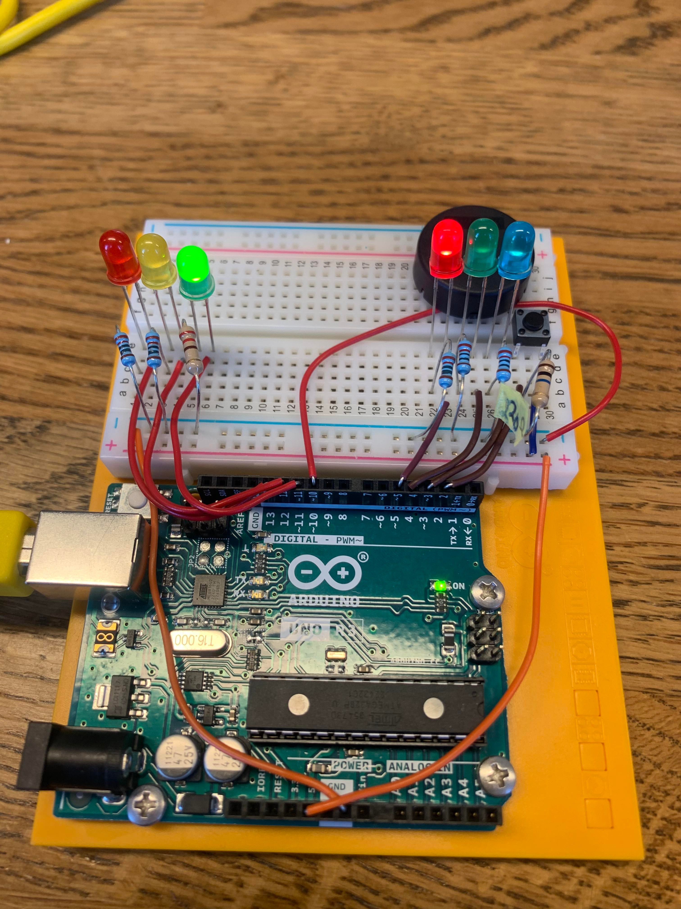

# Assignment 4 — LED Drivers and Arduino Traffic Lights

LED circuit analysis and an Arduino-controlled pedestrian crossing for **IN1080: Mechatronics**, University of Oslo.

**Author:** Frida Berge (`fridatbe`)  
**Report date:** March 16, 2023

## Overview

This assignment consists of two parts:

1. **LED driver design:** Investigate the relationship between LED voltage and current, compare two diode models, and evaluate current limiting with a series resistor.
2. **Traffic-light control:** Design and assemble an Arduino circuit for a pedestrian crossing with vehicle lights, pedestrian lights, a request button and audible signals.

## Report and Task Description

- [My report](./oblig4_fridatbe.pdf) — calculations, Python code excerpts, circuit schematic and hardware photo.
- [Report source](./oblig4_fridatbe.tex) — LaTeX source for the written submission.
- [Task description](./taskdescription.pdf) — original assignment instructions and requirements.

## Folder Structure

```text
oblig4/
├── README.md
├── taskdescription.pdf
├── oblig4_fridatbe.pdf
├── oblig4_fridatbe.tex
├── code/
│   ├── README.md
│   └── Source code files
└── media/
    ├── README.md
    └── Supporting images
```

## Part I — LED Driver Design

### Tasks 1–2: LED Current Without a Series Resistor

Plot the current–voltage characteristic of an LED and calculate the current at a fixed supply voltage of 1.14 V.

The assignment compares LEDs with ideality factors of 1.6 and 1.3.

| LED ideality factor | Calculated current at 1.14 V |
| --- | ---: |
| 1.6 | Approximately 0.93 A |
| 1.3 | Approximately 537 A |

These are results from the assignment’s simplified diode model, not measured currents or safe operating recommendations. They illustrate how strongly the predicted current depends on the diode parameters when no current-limiting element is used.

### Tasks 3–4: Adding a Series Resistor

Formulate the relationship between the supply voltage, resistor voltage drop and LED current.

For a 10 V supply and a target current of 1 A, the assignment asks for an approximate resistor value assuming a 1 V drop across the LED.

The report obtains a resistance of **9 Ω**.

### Task 5: Numerical Current Calculation

Use Python to iteratively calculate the current with the 9 Ω series resistor and a 10 V supply.

| LED ideality factor | Reported numerical current |
| --- | ---: |
| 1.6 | Approximately 0.984 A |
| 1.3 | Approximately 1.007 A |

Compared with the direct-voltage calculations, the series resistor greatly reduces the current difference between the two LED models.

**Note:** The 9 Ω resistor belongs to the theoretical LED-driver exercise. The Arduino traffic-light circuit uses 220 Ω resistors for its LEDs.

## Part II — Arduino Traffic Lights

### Circuit Design and Assembly

The report includes a circuit schematic and a photograph of the assembled Arduino Uno breadboard circuit.

The system uses:

- Three vehicle LEDs: red, yellow and green.
- Two pedestrian LEDs: red and green.
- One blue LED to acknowledge a crossing request.
- A pushbutton with a 10 kΩ pull-down resistor.
- A piezo sounder.
- Six 220 Ω LED current-limiting resistors.

### Hardware Setup



*Breadboard assembly for the traffic-light exercise.*

### Required Traffic-Light Sequence

The following behavior is specified by the assignment:

1. **Idle:** Vehicles have a green light and pedestrians have a red light. The piezo alternates between 0.5 seconds off and 0.5 seconds on.
2. **Request received:** The blue LED acknowledges the button press until pedestrians receive a green light.
3. **Vehicle stop:** After 2 seconds, the vehicle light changes to yellow; 1 second later, it changes to red.
4. **Pedestrian crossing:** After a further 1 second, the pedestrian light changes to green. The piezo alternates between 0.125 seconds off and 0.125 seconds on.
5. **Crossing ends:** After 6 seconds of pedestrian green, the green LED flashes for three cycles, with 0.5 seconds off and 0.5 seconds on per cycle, before returning to red.
6. **Vehicle restart:** Once pedestrians have red, the vehicle light changes to yellow for 1 second, then returns to green.

The assignment requires non-blocking control and interrupt-based handling of the request button.

### Pin Assignments

| Arduino pin | Component | Purpose |
| --- | --- | --- |
| D2 | Pushbutton | Pedestrian crossing request |
| D3 | Blue LED | Request acknowledgement |
| D4 | Green LED | Pedestrian green |
| D5 | Red LED | Pedestrian red |
| D10 | Piezo sounder | Audible signal |
| D11 | Green LED | Vehicle green |
| D12 | Yellow LED | Vehicle yellow |
| D13 | Red LED | Vehicle red |

## Software

- **Python:** LED current calculations, plotting and numerical iteration.
- **Arduino IDE:** Compiling and uploading the traffic-light sketch.
- **LaTeX:** Preparing the written report.

See [code/README.md](./code/README.md) for usage guidance.

## Documentation Notes

The PDF preserves my original submission. The numerical results above are taken from that report.

The traffic-light sequence above describes the assignment requirements; the source code should be consulted to verify the implementation.

## Safety

Disconnect power before changing the wiring. Use a current-limiting resistor for every LED and follow the course’s laboratory safety procedures.

The high-current examples in Part I are mathematical exercises, not instructions for connecting LEDs directly to a supply or drawing those currents from Arduino pins.

## Attribution

The assignment instructions and supplied reference circuits were provided by the course.

My submission includes the LED calculations, Python code excerpts, circuit schematic and hardware documentation presented in the report.
