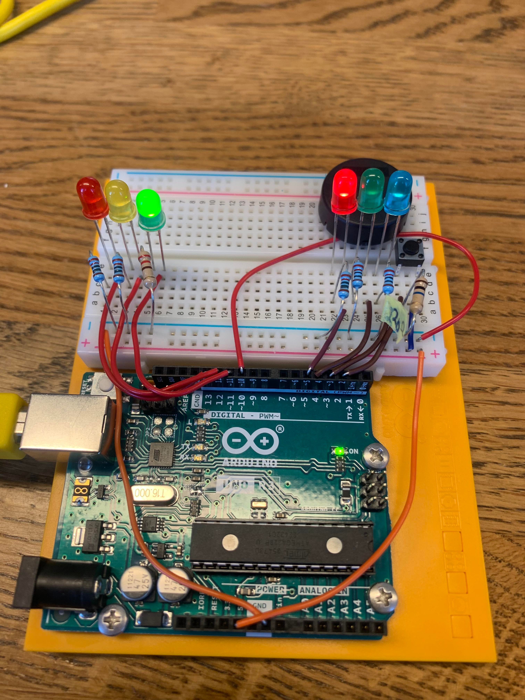

# Media — Assignment 4

Supporting visual material for **IN1080: Mechatronics**, Assignment 4.

## Traffic-Light Hardware Setup

*Arduino Uno breadboard assembly with vehicle LEDs, pedestrian LEDs, a blue request indicator, a pushbutton and a piezo sounder.*

The circuit represents a pedestrian crossing:

- **Vehicle lights:** Red, yellow and green LEDs.
- **Pedestrian lights:** Red and green LEDs.
- **Request indicator:** Blue LED.
- **User input:** Pushbutton.
- **Audible signal:** Piezo sounder.

Each LED uses a 220 Ω current-limiting resistor. The pushbutton uses a 10 kΩ pull-down resistor.

The photo documents the physical assembly. It does not, by itself, demonstrate the timing or complete traffic-light sequence.

## Other Visual Documentation

The report also includes:

- An LED current–voltage plot.
- Circuit diagrams for the LED-driver calculations.
- A schematic for the traffic-light circuit.

See the report for the context and explanation of these figures.

## Related Documentation

- [Assignment overview and pin mapping](../README.md)
- [My calculations and hardware documentation](../oblig4_fridatbe.pdf)
- [Original task description](../taskdescription.pdf)
- [Source code](../code/)

## Attribution

The hardware photo documents my assembled circuit.

Course-supplied reference diagrams and illustrations remain attributable to the original assignment.
