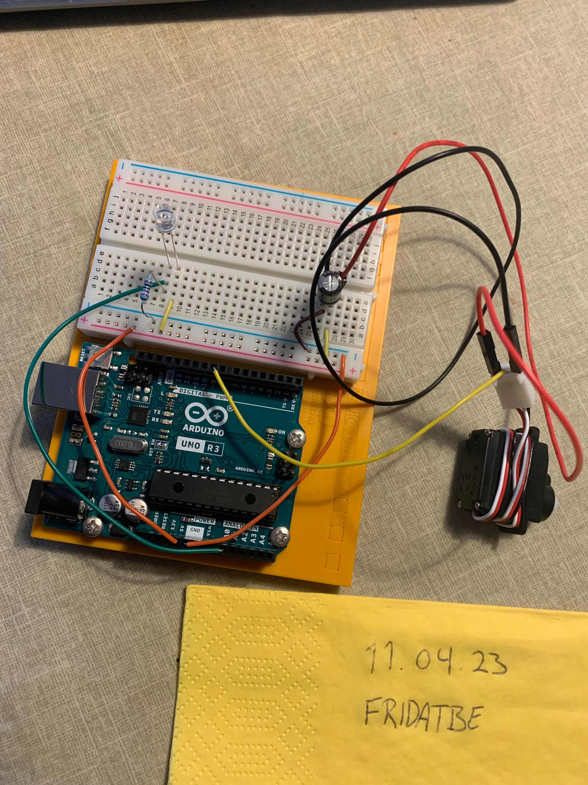
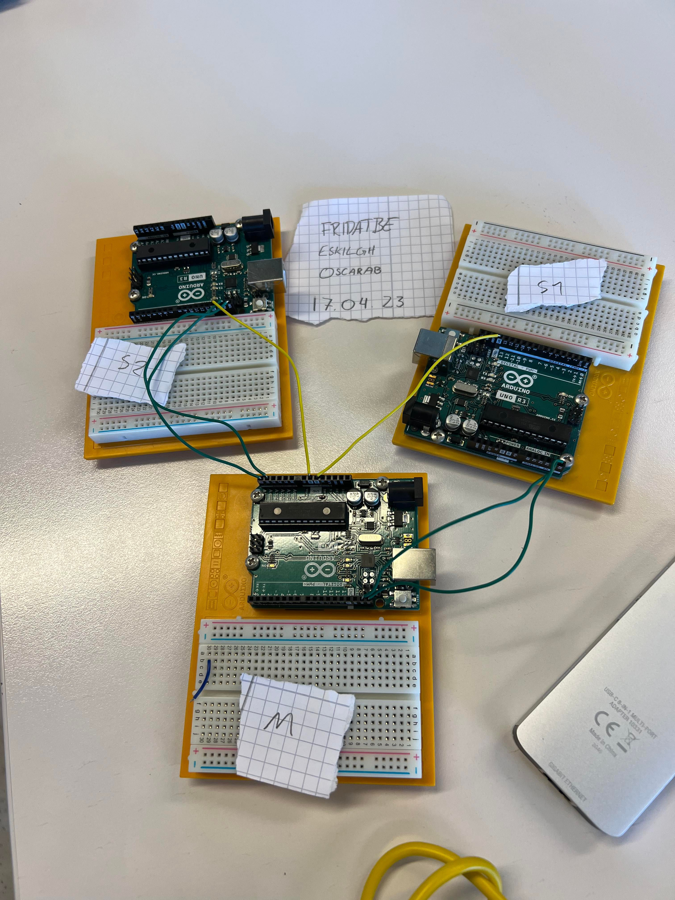
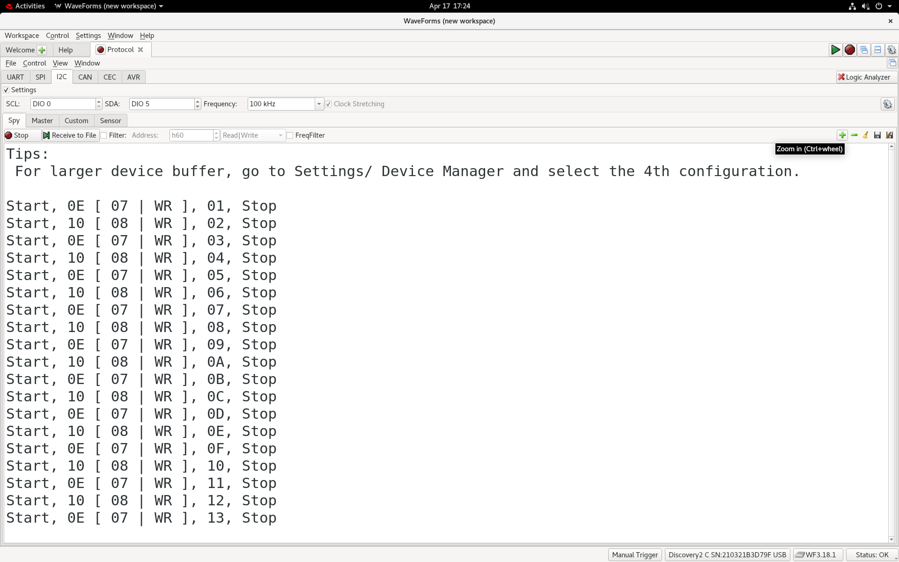

# Assignment 5 — Servo Control and I²C Communication

Light-controlled servo operation and communication between three Arduino boards for **IN1080: Mechatronics**, University of Oslo.

**Author:** Frida Berge (`fridatbe`)

## Overview

This assignment consists of two practical tasks:

1. **Servo control:** Build an instrument that indicates light intensity using a phototransistor and a servo.
2. **I²C communication:** Connect three Arduino boards and use mouse-click input to control the built-in LEDs on two receiving boards.

Task 2 was completed in collaboration with two other students. See the report and source-code comments for collaborator details.

## Documentation

- [My report](./oblig5_fridatbe.pdf) — written submission and experiment documentation.
- [LaTeX source](./oblig5_fridatbe.tex) — source for the report.
- [Task description](./taskdescription.pdf) — original instructions and requirements.
- [Code documentation](./code/README.md) — sketch descriptions and usage.
- [Media documentation](./media/README.md) — setup photos, servo video and I²C capture.

## Folder Structure

```text
oblig5/
├── README.md
├── taskdescription.pdf
├── oblig5_fridatbe.pdf
├── oblig5_fridatbe.tex
├── code/
│   ├── README.md
│   ├── oblig5_1_fridatbe.ino
│   ├── oblig5_2_fridatbe.ino
│   ├── oblig5_i2cmaster_fridatbe.ino
│   ├── oblig5_i2cslave1_fridatbe.ino
│   └── oblig5_i2cslave2_fridatbe.ino
└── media/
    ├── README.md
    ├── bilde_servo.jpg
    ├── video_servo.mp4
    ├── oppsett_BUS.jpg
    └── screen.png
```

## Task 1 — Light-Controlled Servo

### Objective

Use a phototransistor to measure light intensity and a servo to indicate the reading through its angular position.

The Arduino reads the sensor using `analogRead()` and maps the input range of 0–1023 to the servo's angular range of 0–180 degrees. Servo control uses the built-in `Servo.h` library.

### Components

- Arduino Uno.
- Servo.
- Phototransistor.
- 10 kΩ resistor.
- 100 µF capacitor.
- Breadboard and jumper wires.

### Setup and Result



*Hardware setup for Task 1.*

[Watch the servo demonstration](./media/video_servo.mp4)

The video documents the servo's response during the experiment.

**Sketch:** [oblig5_1_fridatbe.ino](./code/oblig5_1_fridatbe.ino)

## Task 2 — I²C Communication Between Three Arduinos

### Objective

Use one controller board, called the master in the assignment, to send mouse-click input alternately to two receiving boards, called slaves.

The Processing program from Assignment 1 supplies mouse-click input over the serial connection. The controller forwards the input over I²C using `Wire.h`, and each receiving board toggles its built-in LED.

### Bus Connections

Connect the three Arduino Uno boards using:

| Connection | Arduino Uno pin |
| --- | --- |
| SDA — data | A4 |
| SCL — clock | A5 |
| Common ground | GND |

Each Arduino is powered through a separate USB cable.

### Expected Click Sequence

| Mouse click | Action |
| --- | --- |
| First | Receiver 1 LED turns on |
| Second | Receiver 2 LED turns on |
| Third | Receiver 1 LED turns off |
| Fourth | Receiver 2 LED turns off |

The sequence then repeats.

### Setup



*Hardware setup for the collaborative I²C task.*

### Captured Result



*Recorded output from the I²C experiment.*

Analog Discovery 2 and the WaveForms Protocol Analyzer are used to inspect communication on the SDA and SCL lines.

### Main Sketches

- [Controller](./code/oblig5_i2cmaster_fridatbe.ino)
- [Receiver 1](./code/oblig5_i2cslave1_fridatbe.ino)
- [Receiver 2](./code/oblig5_i2cslave2_fridatbe.ino)

The folder also includes [oblig5_2_fridatbe.ino](./code/oblig5_2_fridatbe.ino), an additional Task 2 sketch. Consult its contents for its specific role.

## Software and Equipment

- Arduino IDE.
- Arduino `Servo.h` and `Wire.h` libraries.
- Processing and the mouse-click program from Assignment 1.
- Analog Discovery 2 with WaveForms.
- Three Arduino Uno boards for Task 2.

## Safety

Disconnect power before changing wiring. Observe the polarity of the capacitor and follow the course's laboratory safety procedures.

For the I²C experiment, use separate USB power connections and a common ground. Do not connect the boards' 5 V rails together merely to establish the bus.

## Attribution

The assignment instructions and reference wiring diagrams were provided by the course.

Task 2 was completed collaboratively with two other students. The report and code comments should identify all participants.
