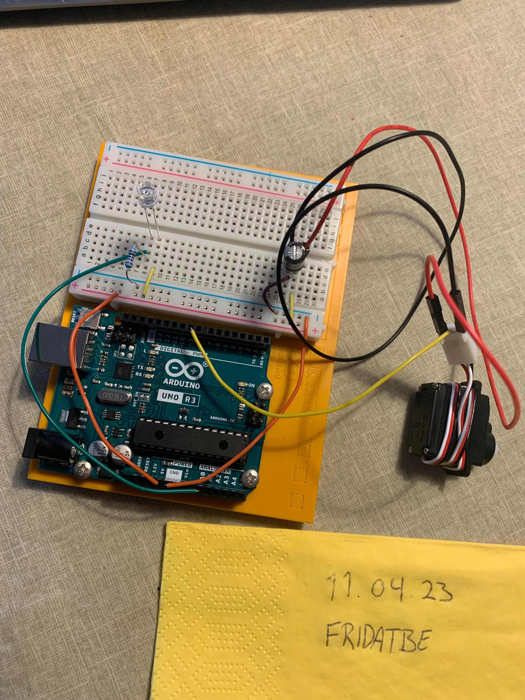
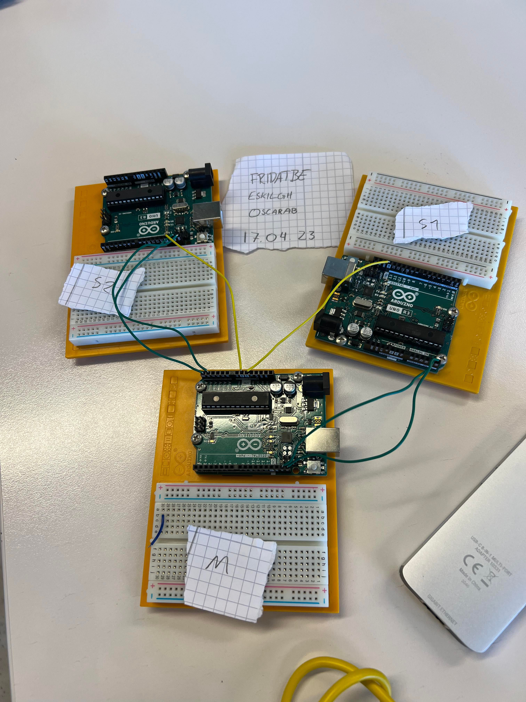
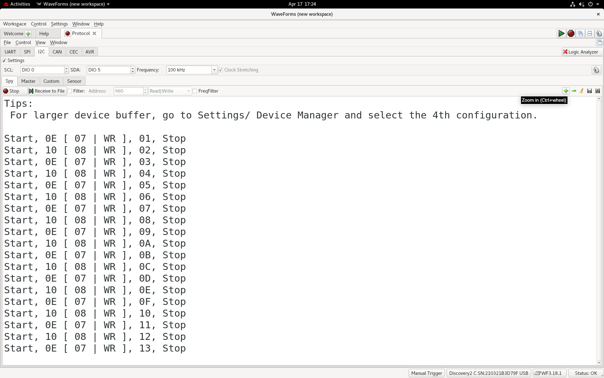

# Media — Assignment 5

Setup photos and recorded results for **IN1080: Mechatronics**, Assignment 5.

## Files

| File | Contents |
| --- | --- |
| [bilde_servo.jpg](./bilde_servo.jpg) | Task 1: Servo and phototransistor setup |
| [video_servo.mp4](./video_servo.mp4) | Task 1: Servo demonstration |
| [oppsett_BUS.jpg](./oppsett_BUS.jpg) | Task 2: Three-Arduino I²C setup |
| [screen.png](./screen.png) | Task 2: I²C communication capture |

## Task 1 — Light-Controlled Servo

### Setup

*Hardware setup for the light-intensity indicator.*

The circuit uses a phototransistor as the light sensor and a servo to indicate the reading. It also includes a 10 kΩ resistor and a 100 µF capacitor.

### Result

[Watch the servo demonstration video](./video_servo.mp4)

The video shows the result of the servo-control experiment.

GitHub may offer the video as a downloadable file rather than playing it directly in this README.

**Related sketch:** [oblig5_1_fridatbe.ino](../code/oblig5_1_fridatbe.ino)

## Task 2 — I²C Communication

This task was completed in collaboration with two other students.

### Setup

*Collaborative I²C experiment with one controller and two receiving boards.*

The boards share SDA on A4, SCL on A5 and a common ground. Each board is powered by a separate USB cable.

### Result

*Recorded communication from the I²C experiment.*

The task uses mouse clicks from Processing to send input alternately to two receiving Arduino boards. Each receiver toggles its built-in LED when addressed.

The capture documents the bus communication; the report provides the accompanying explanation.

### Related Sketches

- [I²C controller](../code/oblig5_i2cmaster_fridatbe.ino)
- [I²C receiver 1](../code/oblig5_i2cslave1_fridatbe.ino)
- [I²C receiver 2](../code/oblig5_i2cslave2_fridatbe.ino)

## Related Documentation

- [Assignment overview](../README.md)
- [Code documentation](../code/README.md)
- [My report](../oblig5_fridatbe.pdf)
- [Original task description](../taskdescription.pdf)

## Attribution

These files document the practical experiments submitted for Assignment 5.

The I²C setup and experiment were completed collaboratively. See the report and code comments for participant details.
