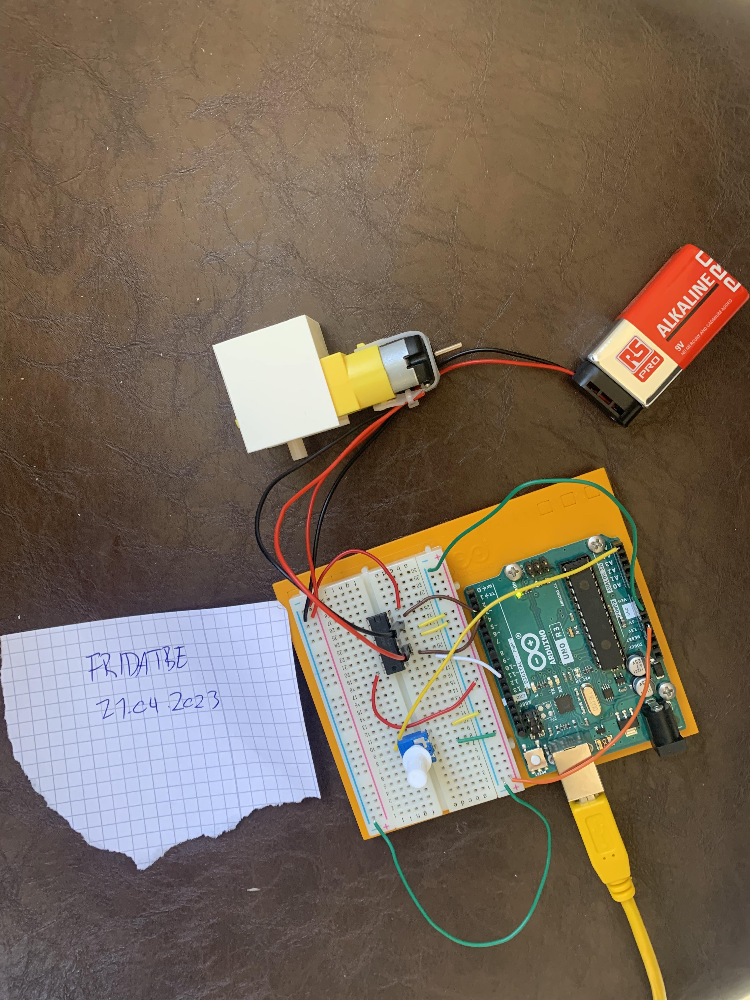
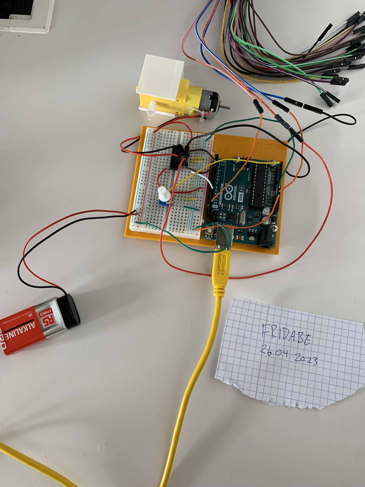
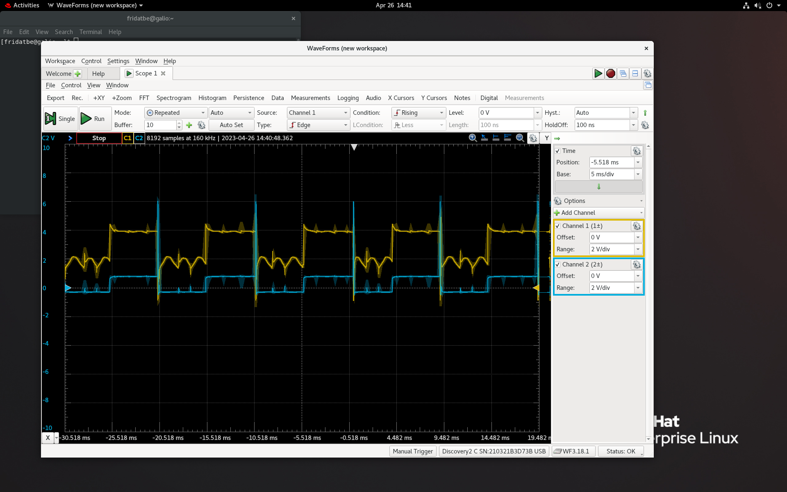
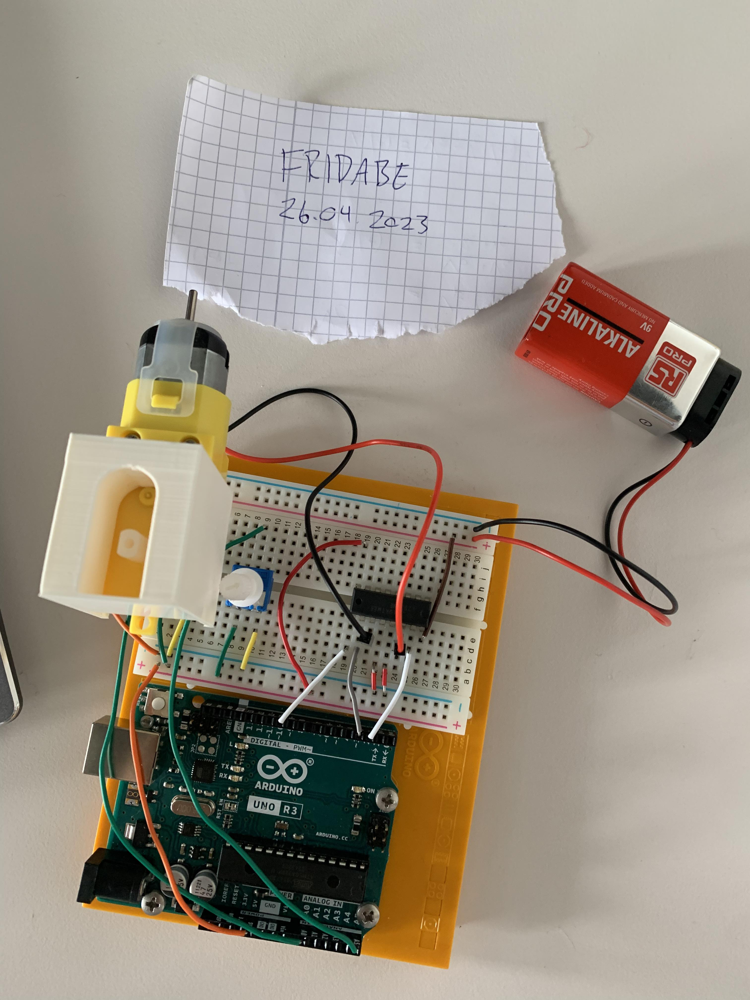

# Assignment 6 — PWM and DC-Motor Position Control

Practical work with DC motors, software-generated pulse-width modulation (PWM), and a homemade servo for **IN1080: Mechatronics**, University of Oslo.

**Author:** Frida Berge (`fridatbe`)

## Overview

The assignment consists of two tasks:

1. Control a DC motor using non-blocking PWM and inspect the signals with an oscilloscope.
2. Build a servo from a DC motor and potentiometer, then implement PID position control.

## Repository Contents

| Path | Contents |
| --- | --- |
| [code/](./code/) | Arduino sketches and code documentation |
| [media/](./media/) | Setup photos and PWM waveform capture |
| [fridatbe_oblig6.pdf](./fridatbe_oblig6.pdf) | Written report |
| [fridatbe_oblig6.tex](./fridatbe_oblig6.tex) | LaTeX source for the report |
| [Taskdescription.pdf](./Taskdescription.pdf) | Original assignment instructions |

## Task 1 — Pulse-Width Modulation

### Part A: Motor Circuit

Connect a DC motor to an Arduino Uno through an L293D motor driver. A potentiometer provides the input for adjusting the PWM duty cycle, and a 9 V battery supplies the motor circuit.

*Hardware setup for Task 1A.*

### Part B: Software PWM

The task requires PWM generation on Arduino pin 10 using `digitalWrite()`, without `analogWrite()` or blocking code.

The potentiometer controls the duty cycle. The assignment recommends a frequency around 100 Hz and specifies an upper limit of 5 kHz for this exercise.

**Sketch:** [fridatbe_oblig6_opg1.ino](./code/fridatbe_oblig6_opg1.ino)

### Part C: Oscilloscope Measurement

Analog Discovery 2 and WaveForms are used to inspect the motor-driver output signals.

*Measurement setup for Task 1C.*

*WaveForms capture showing the PWM waveform and duty cycle.*

The assignment asks for a capture with the duty cycle adjusted to approximately 50%. See the report for the recorded measurement and discussion.

## Task 2 — Build a Servo

### Objective

Build a position-controlled motor assembly using:

- A DC motor.
- An L293D motor driver.
- A 9 V battery.
- Two potentiometers.
- A motor bracket and coupler.
- An Arduino Uno.

One potentiometer supplies the target position. The other is mechanically coupled to the motor and provides position feedback.

### Position Control

The controller compares the requested position with the measured position. A PID controller determines the motor-control output, while software-generated PWM regulates the motor drive.

The assignment describes an approximate mechanical range of 240 degrees.

*Motor, potentiometer and control-circuit setup for Task 2.*

**Sketch:** [fridatbe_oblig6_opg2.ino](./code/fridatbe_oblig6_opg2.ino)

See the [report](./fridatbe_oblig6.pdf) for the selected PID parameters and discussion of the experiment.

## Software and Equipment

- Arduino IDE.
- Arduino Uno.
- L293D motor driver and DC motor.
- Potentiometers and a 9 V battery.
- Analog Discovery 2 with WaveForms.
- Motor bracket and coupler for Task 2.
- Optional course-provided Processing interface with ControlP5 for PID tuning.

The Processing interface is supplied through the course materials and is not listed among this folder's files.

## Safety

- Disconnect power before changing wiring.
- Check battery polarity and motor-driver connections.
- Avoid short circuits and use a common ground between the control and motor circuits.
- Wire both potentiometers consistently so matching positions produce comparable readings.
- Avoid driving the feedback potentiometer beyond its mechanical limits.
- Preserve the safety functions in the course-provided Task 2 template.
- Test Task 2 with the template's default PID values before using the Processing tuning interface.

## Further Documentation

- [Code README](./code/README.md)
- [Media README](./media/README.md)
- [Written report](./fridatbe_oblig6.pdf)
- [Task description](./Taskdescription.pdf)

## Attribution

The assignment instructions, circuit diagrams, Task 2 code template and optional Processing interface were provided by the course.
