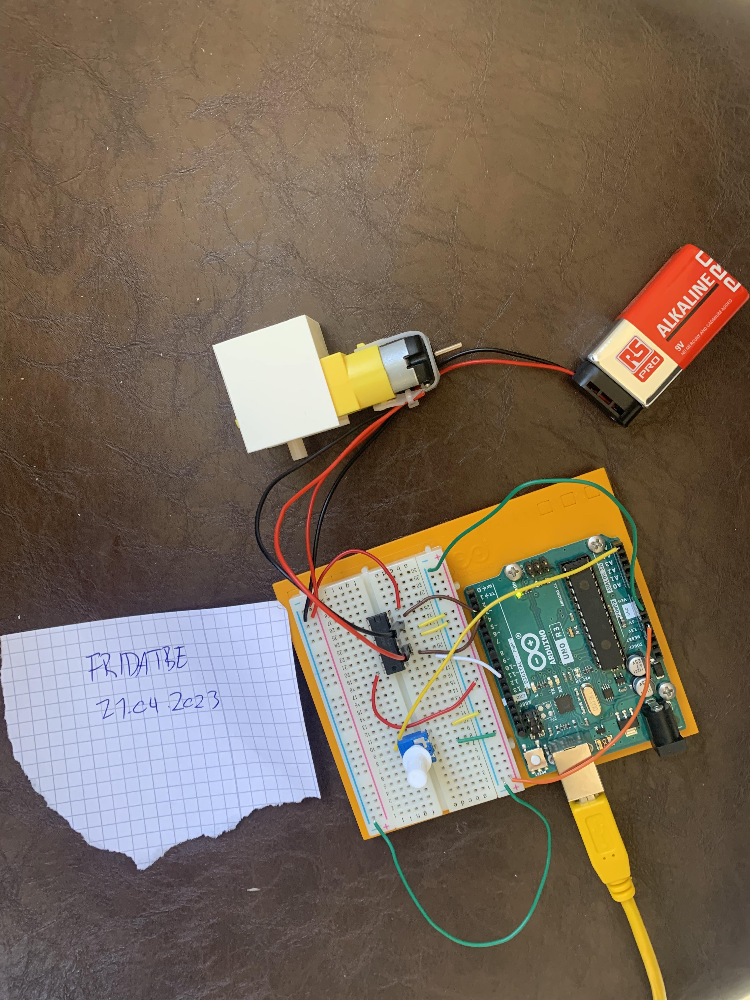
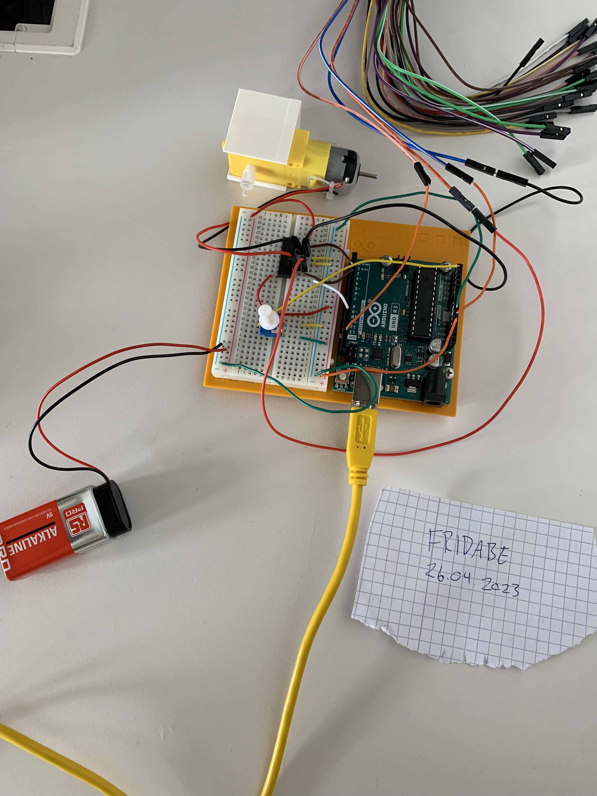
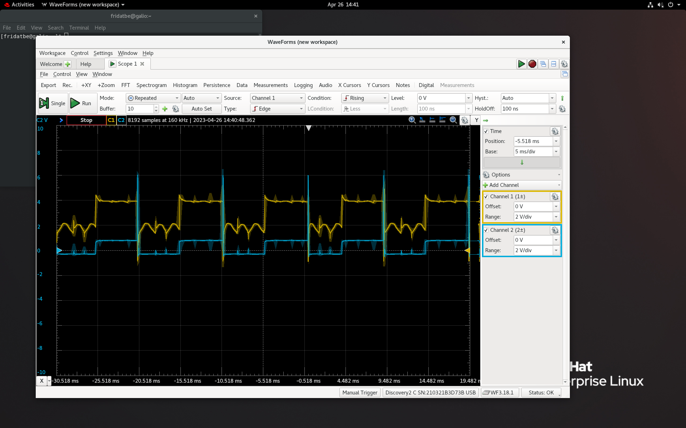
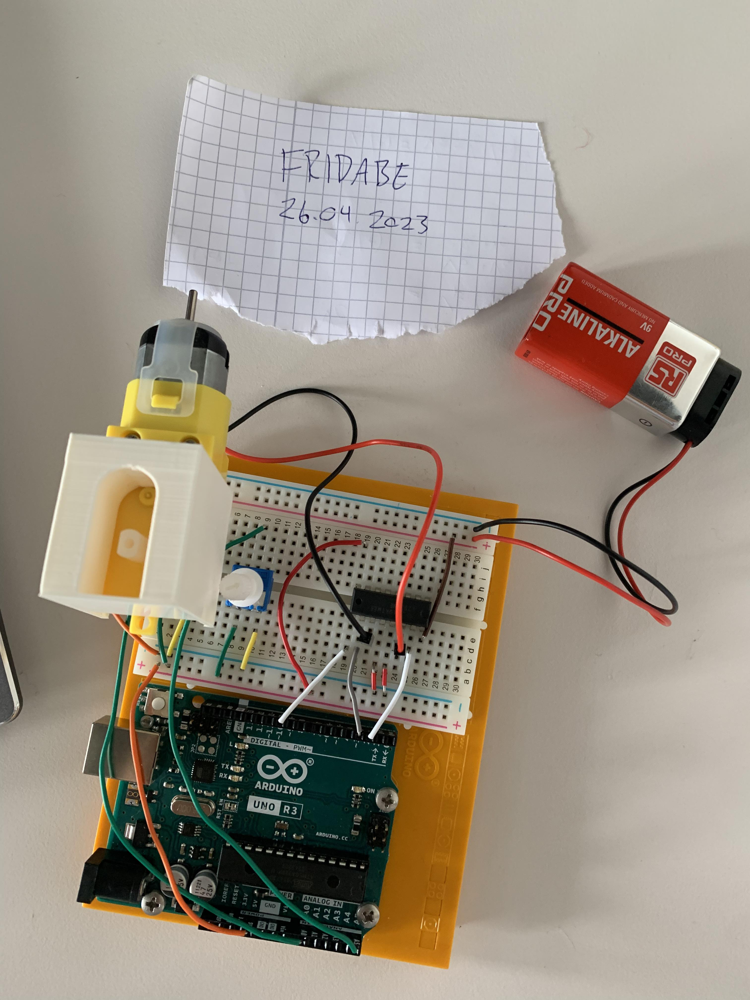

# Media — Assignment 6

Setup photos and a PWM waveform capture for **IN1080: Mechatronics**, Assignment 6.

## Files

| File | Description |
| --- | --- |
| [oppsett.jpg](./oppsett.jpg) | Task 1A: DC-motor circuit setup |
| [bilde_oppsett.jpg](./bilde_oppsett.jpg) | Task 1C: Oscilloscope measurement setup |
| [screen.png](./screen.png) | Task 1C: PWM waveform showing duty cycle |
| [oppsett2.jpg](./oppsett2.jpg) | Task 2: Homemade servo setup |

## Task 1A — DC-Motor Circuit

*Hardware setup for Task 1A.*

The circuit uses an Arduino Uno, an L293D motor driver, a DC motor, a potentiometer and a 9 V battery.

The potentiometer supplies the input used to adjust the PWM duty cycle.

**Related sketch:** [fridatbe_oblig6_opg1.ino](../code/fridatbe_oblig6_opg1.ino)

## Task 1C — PWM Measurement

### Measurement Setup

*Setup for inspecting the motor-driver output signals with Analog Discovery 2.*

The assignment specifies measuring the two driver outputs on separate oscilloscope channels, with both negative inputs connected to circuit ground.

### Waveform Capture

*WaveForms graph showing the PWM signal and duty cycle.*

The assignment asks for a capture at approximately 50% duty cycle. See the report for the recorded values and interpretation of the graph.

## Task 2 — Homemade Servo

*Hardware setup for Task 2.*

The assembly combines a DC motor, motor bracket, coupler and feedback potentiometer. A second potentiometer provides the target position.

The Arduino uses PID control and software-generated PWM to drive the motor toward the requested position.

This photo documents the setup; see the report for the controller parameters and discussion of its behavior.

**Related sketch:** [fridatbe_oblig6_opg2.ino](../code/fridatbe_oblig6_opg2.ino)

## Related Documentation

- [Assignment overview](../README.md)
- [Code documentation](../code/README.md)
- [Written report](../fridatbe_oblig6.pdf)
- [Original task description](../Taskdescription.pdf)

## Attribution

These files document the practical experiments for Assignment 6. The circuit and assembly instructions were provided by the course.
